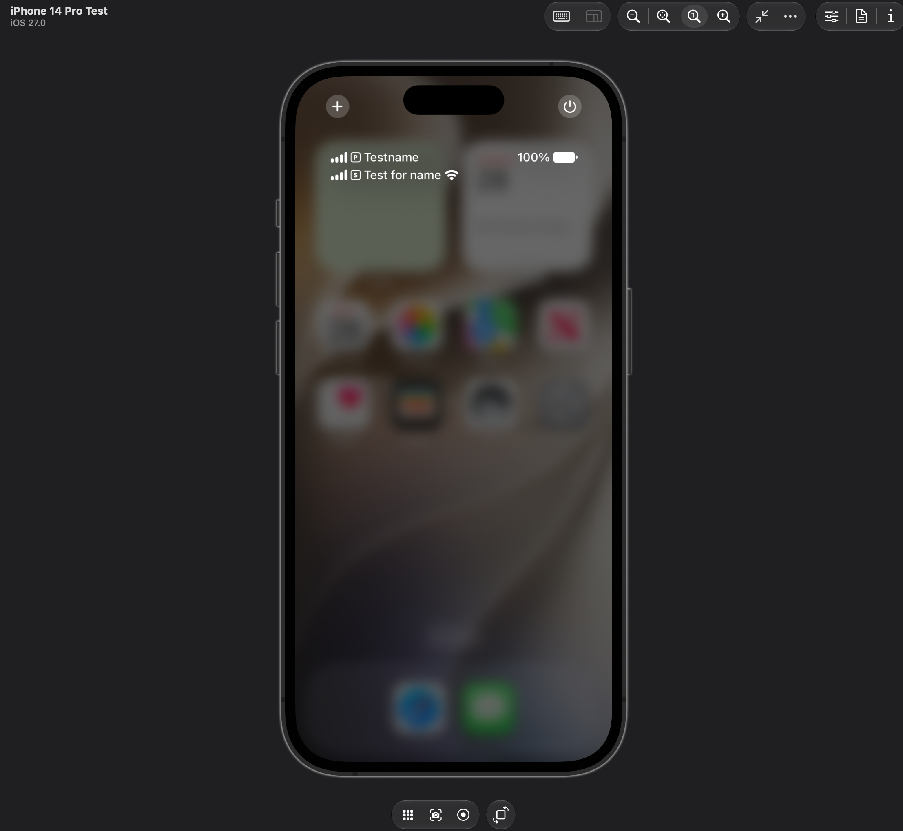
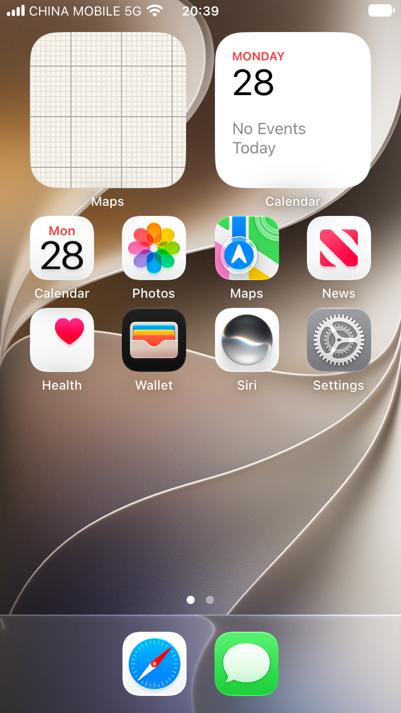

# Universal iOS 27 Carrier & Lock Screen Customization Suite

[English](README.md) | [简体中文](README_ZH.md) | [Documentation Hub (Docs Hub)](docs/README.md)

[](https://apple.com/ios)
[](#-upstream-adoption--end-to-end-verification-status)
[](#-upstream-adoption--end-to-end-verification-status)
[-orange.svg)](#-universal-hardware--display-matrix)

> A universal, non-jailbreak reverse engineering framework and automation toolchain for customizing **Cellular Carrier Name** (Single/Dual SIM) and **Lock Screen Footnote** across **all iOS 27.x devices** (Dynamic Island and Classic Notch/Home models).

---

## 🎯 Executive Summary & Status

| Target Feature | iOS 27 Status | Core Mechanism | Viability & Scope |
|---|:---:|---|---|
| **Lock Screen Footnote** | 🟢 **VIABLE** | `SharedDeviceConfiguration.plist` under `com.apple.shareddeviceconfiguration` | **Universal (100%)** — Native Apple MDM profile (`.mobileconfig`) or Protective Backup Injection via `SysSharedContainerDomain`. Zero exploit required. (Note: specific corporate policies may require Supervision). |
| **Carrier Name Override (StatusBarOverrides)** | 🟢 **VERIFIED (BREAKTHROUGH)** | Modern `StatusBarOverrides.archive` (`_SBSystemStatusStatusBarOverridesArchiveRecord`) | **Verified End-to-End on Physical Hardware** — Officially merged into [GoldenNugget](https://github.com/GoldenNugget-Team/GoldenNugget) (v9.5.1 / v9.5.2) in Commit [`55dfdeab`](https://github.com/GoldenNugget-Team/GoldenNugget/commit/55dfdeab6a9b0c50d55f80ae4aaaa42cc8e083c4); lead developer `@awesomenull` updated the verification status in Commit [`dbb000cb`](https://github.com/GoldenNugget-Team/GoldenNugget/commit/dbb000cb248e91a0ad53378a5f5d227d1540d562) to **"Verified end-to-end by me and other users"**. Delivered via standard `HomeDomain` backup restore (`MobileBackup2`) or the in-repo AirLift USB pipeline. |
| **VPN Badge Retention** | 🟢 **FIXED (100% Passthrough)** | Clean Overlay Passthrough: `suppressedBackgroundActivityIdentifiers = []` + omit `vpnEntry` | **Universal (100%)** — Resolves the defect in GoldenNugget and historical archives where the VPN badge disappears from Control Center and the status bar. Native live VPN status passes through cleanly; CLI and GUI also support explicit `--vpn {auto,on,off}` controls. |
| **Dynamic Carrier & Real Signal (Upstream)** | 🔴 **EXPERIMENTALLY BLOCKED** | Signed carrier bundle + CommCenter state in `/var/wireless/Library/Preferences/` | **No non-jailbreak write path** — Disassembly proved `-[STStatusBarData dataByApplyingOverlay:]` performs atomic pointer replacement of `cellularEntry`. CommCenter runs under UID 257 (`_wireless`) with SSV signature verification, isolating backup injection from mobile space. See [Dynamic Carrier Resolution Report](docs/EN/04_research_handoffs/2026-10-21_dynamic-carrier-and-vpn-resolution.md). |

---

## 📱 Universal Hardware & Display Matrix

This project supports all devices capable of running **iOS 27.x** (Builds `24A300`, `24A434`, `24A435`, `24A437`, `24A446`, and later):

| Device Family | Models | Display Type | Cellular Rendering Behavior | Verification Status |
|---|---|---|---|---|
| **Dynamic Island (Pro)** | iPhone 14/15/16 Pro & Pro Max | 灵动岛 (Dynamic Island) | **Single SIM**: Full-height 4-bars in trailing ear.<br>**Dual SIM**: Native stacked 4-bars (Primary) + 4-dots (Secondary).<br>**Text Display**: Alternating ticker on Lock Screen; full labels (`[P] Carrier`, `[S] Carrier`) in Control Center. | 🟢 **Physical (iPhone 16 Pro Max / 14 Pro) + Simulator** |
| **Dynamic Island (Base)** | iPhone 15/15 Plus, 16/16 Plus | 灵动岛 (Dynamic Island) | Identical to Pro models; responsive Dynamic Island layout. | 🟢 **Fully Compatible** |
| **Classic Notch & Home** | iPhone 13/14/Plus, iPhone SE (2nd/3rd gen) | 经典顶部状态栏 (Classic/Notch) | Direct top-left status bar text display (`Carrier 5G` + signal bars). | 🟢 **Simulator Verified** |

---

## 🚀 Upstream Adoption & End-to-End Verification Status

Our reverse engineering of `SBSystemStatusStatusBarOverridesArchiver` successfully broke the community's assumption that iOS 27's Speakeasy gate permanently blocked status bar customization:

1. **Integrated in GoldenNugget**: The [GoldenNugget-Team/GoldenNugget](https://github.com/GoldenNugget-Team/GoldenNugget) suite officially integrated our research in Commit [`55dfdeab`](https://github.com/GoldenNugget-Team/GoldenNugget/commit/55dfdeab6a9b0c50d55f80ae4aaaa42cc8e083c4), shipping the revival of iOS 27 status bar customization in **GoldenNugget 9.5.1 and 9.5.2**.
2. **End-to-End Physical Verification (Confirmed)**: In Commit [`dbb000cb`](https://github.com/GoldenNugget-Team/GoldenNugget/commit/dbb000cb248e91a0ad53378a5f5d227d1540d562) and official documentation ([`docs/iOS27_StatusBar_Research.md`](https://github.com/GoldenNugget-Team/GoldenNugget/blob/main/docs/iOS27_StatusBar_Research.md)), lead maintainer `@awesomenull` updated the verification status to **`"Verified end-to-end by me and other users"`**. Real hardware tests confirmed byte-for-byte fidelity against physical iOS 27 dumps.
3. **HomeDomain Backup Delivery**: GoldenNugget verified that `/var/mobile/Library/SpringBoard/StatusBarOverrides.archive` resides in `HomeDomain`. Delivering it via standard `MobileBackup2` backup restore completely bypasses AirTraffic ATAirlock rename overwrite limitations without exploits or jailbreaks.
4. **AirLift Channel Physical Verification**: The in-repo AirLift channel was independently verified on **iPhone 16 Pro Max (iOS 27.0, 24A437)** and **iPhone 14 Pro (iOS 27.0.1, 24A446)** over wired USB, confirming delivery, rendering, and persistence across reboots.

---

## 📸 Visual Verification & Empirical Proof

| Control Center Dual SIM (iPhone 14 Pro Physical) | Classic Status Bar (iPhone SE Physical/Sim) |
|:---:|:---:|
|  |  |
| **Dual SIM Custom Carrier**: `[P] Testname` & `[S] Test for name` | **Single SIM Custom Carrier**: `中国广电 5G` |

---

## 🏗️ Architecture & Core Mechanics

### 1. Modern StatusBarOverrides.archive Architecture
Unlike iOS 14–16 which expected a raw 3944-byte C struct in `statusBarOverrides`, iOS 27 uses an **NSKeyedArchiver binary property list**:
- **Target Path**: `/var/mobile/Library/SpringBoard/StatusBarOverrides.archive`
- **Ownership**: `mobile:mobile` (0644)
- **Root Class**: `_SBSystemStatusStatusBarOverridesArchiveRecord`
  - `statusBarData`: `STStatusBarData` (from `SystemStatus.framework`)
  - `suppressedBackgroundActivityIdentifiers`: `NSSet` (kept empty `[]` to prevent suppressing status items like VPN)

### 2. SpringBoard Overlay Processing & VPN Passthrough Fix
```text
┌────────────────────────────────────────────────────────────────────────┐
│                   SpringBoard Overlay Processing                       │
│                                                                        │
│   Native System Status Items                StatusBarOverrides.archive │
│   (CommCenter, Baseband, VPN)               (_SBSystemStatus...Record) │
│               │                                         │              │
│               ▼                                         ▼              │
│   [Base STStatusBarData] ─────────────► [-[STStatusBarData             │
│   - cellularEntry (live baseband)        dataByApplyingOverlay:]]      │
│   - vpnEntry (live VPN connection)                      │              │
│               │                                         │              │
│               ├─────────────────────────────────────────┤              │
│               ▼                                         ▼              │
│   [cellularEntry: Pointer Replace]        [vpnEntry: Native Passthrough]
│   • Replaces whole cellularEntry pointer   • overlay.vpnEntry == nil      │
│   • Renders custom carrier text            • cbz skips replace, live VPN  │
│   • Static override: persists in airplane  • Fixes GoldenNugget VPN loss  │
└────────────────────────────────────────────────────────────────────────┘
```
- **Atomic Pointer Replacement**: Disassembly of `-[STStatusBarData dataByApplyingOverlay:]` (`0x20e4ac960`) proved that SpringBoard replaces entries at object-pointer granularity. Because custom text requires `status = 5, enabled = true`, static overrides remain visible in Airplane Mode.
- **VPN Badge Fix**: Early tools serialized empty `vpnEntry` or added VPN identifiers to suppression sets, causing the VPN badge to vanish. Our toolchain omits `vpnEntry` entirely under `--vpn auto` (default), allowing native VPN daemons to pass through with 100% fidelity.

---

## 🛠️ Toolchain & Quick Start

### 1. Physical Device Direct Deployer (`tools/airlift_carrier_deploy.py`)
```bash
# Compile native helpers (MobileDevice + AirTrafficHost, first run only)
cd airlift && make && cd ..

# Single SIM: Set custom carrier name (default --vpn auto preserves real VPN indicator)
python3 tools/airlift_carrier_deploy.py -c "MyCarrier 5G" -b 4 -t 5g

# Dual SIM: Set primary and secondary carriers with badges
python3 tools/airlift_carrier_deploy.py \
  -c "Primary 5G" --badge "P" \
  -s "Secondary 5G" --secondary-badge "S"

# Reset / Restore native carrier settings
python3 tools/airlift_carrier_deploy.py --reset

# Auto Overwrite (bypass ATAirlock rename limitation for text updates)
python3 tools/airlift_carrier_deploy.py -c "NewCarrier 5G" --force-overwrite

# Standalone SpringBoard restart to apply overrides
python3 tools/airlift_carrier_deploy.py --respring
```

### 2. Modern Web GUI Dashboard (`tools/gui_server.py`)
```bash
python3 tools/gui_server.py
```
- **Key Features**: Zero dependency, automatic USB device detection, responsive bilingual UI (ZH / EN).
- **Controls**: Quick Deploy, Auto Overwrite, Reset System Defaults, VPN Badge Mode selector (Auto / Force On / Force Off), and Lock Screen Footnote `.mobileconfig` generator.

### 3. Standalone Archive Generator & Simulator Deployer (`tools/generate_statusbar_archive.py`)
```bash
# Generate custom archive (auto preserves real VPN icon)
python3 tools/generate_statusbar_archive.py -c " Apple 5G" -b 4 -t 5g -o custom.archive

# Generate and deploy directly to active Booted Simulator
python3 tools/generate_statusbar_archive.py -c "Testname" --deploy-simulator booted

# Inspect / Decode an existing archive
python3 tools/generate_statusbar_archive.py -i custom.archive
```

---

## 📁 Repository Structure & Documentation Hub

All deep-dive reverse engineering reports, empirical verification logs, and chronological research handoffs are organized by **category** and **timeline** with full bilingual support:

👉 **[Go to Documentation Hub (Docs Hub)](docs/README.md)** | **[Chinese Index (ZH)](docs/ZH/README.md)** | **[English Index (EN)](docs/EN/README.md)**

```text
docs/
├── README.md                              # Documentation Hub & Sitemap
├── ZH/                                    # Simplified Chinese Documentation (Classified & Dated)
│   ├── 01_architecture_and_solutions/     # Architecture, Safety Boundaries & Verdicts
│   ├── 02_reverse_engineering/            # Binary Disassembly, Data Flow & Gating Analysis
│   ├── 03_hardware_and_verification/      # Hardware Verification, Dynamic Island & Audits
│   └── 04_research_handoffs/              # Chronological Research Handoffs & Snapshots
└── EN/                                    # Full English Documentation
    ├── 01_architecture_and_solutions/     # Architecture, Safety Boundaries & Verdicts
    ├── 02_reverse_engineering/            # Binary Disassembly, Data Flow & Gating Analysis
    ├── 03_hardware_and_verification/      # Hardware Verification, Dynamic Island & Audits
    └── 04_research_handoffs/              # Chronological Research Handoffs & Snapshots
```

---

## ⚠️ Device Safety Guidelines & Known Limitations

1. **Daily Driver Safety**: The toolchain exclusively writes to SpringBoard's user-owned directory (`mobile:mobile`), **never touching `/var/preferences`**, completely avoiding Apple's iOS 27 Security State Recovery reset wipes.
2. **Activation Timing**: SpringBoard reads `StatusBarOverrides.archive` only once during its boot sequence. The initial deployment requires a SpringBoard restart (`--respring` or via Web GUI). Once loaded, overrides persist across full device reboots.
3. **Static Overrides & Airplane Mode**: The archive pins the cellular entry; custom text remains displayed during Airplane Mode. For dual-SIM devices, using the secondary SIM slot for custom text while leaving the primary SIM native is the recommended workaround.
4. **Note on `--partial`**: Omitting `displayValue`/`type` causes them to decode as `0`, which suppresses network-type (5G/LTE) labels while still failing to decouple Airplane Mode, so `--partial` is **not recommended for production use**.

---

## 🔗 References & Credits

- **AirLift Core & Conduit Exploitation**: [AirLift (0xjohnnydev/airlift)](https://github.com/0xjohnnydev/airlift) and [PyAirLift (awesomenull-dev/PyAirLift)](https://github.com/awesomenull-dev/PyAirLift).
- **Customization Frameworks**: [GoldenNugget (GoldenNugget-Team/GoldenNugget)](https://github.com/GoldenNugget-Team/GoldenNugget) and [GoldenNugget-Mobile](https://github.com/GoldenNugget-Team/GoldenNugget-mobile).
- **iOS Protocol Stack**: [pymobiledevice3 (doronz88/pymobiledevice3)](https://github.com/doronz88/pymobiledevice3).
- **Apple Standards**: [Apple Device Management Schema](https://github.com/apple/device-management).

---

## 📜 License & Disclaimer

This project is licensed under the MIT License. All research is strictly for **educational, defensive security research, and technical exploration purposes**. Apple, iPhone, iOS, SpringBoard, and Dynamic Island are trademarks of Apple Inc.