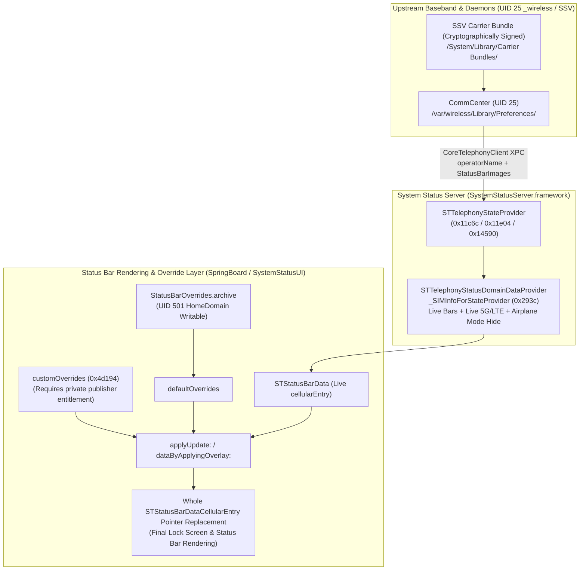

# REA + Ghidra Full-Stack Reverse Engineering & Hardware Verification of Non-StatusBarOverrides Carrier Paths on iOS 27

**Document ID**: `DOC-20261029-REA-ALT-PATHS`  
**Archive Date**: 2026-10-29  
**Target Devices**: iPhone 14 Pro (`iPhone15,2`) / iOS 27.0.1 (Build `24A446`) Physical Device + iOS 27.0 (Build `24A434`) Runtime Image  
**Reverse Engineering Toolchain**: REA (`rea-agents` v6.8.0) + Ghidra 12.1.4 Native Decompiler ([`tools/rea.sh`](../../../tools/rea.sh))  
**Related Documents**: [2026-10-14 CommCenter Disassembly](2026-10-14_commcenter-reverse-engineering.md) · [2026-10-28 Airplane Mode Status Matrix](../04_research_handoffs/2026-10-28_airplane-mode-status-matrix.md) · [2026-10-28 Name-Only Live Override Research](../04_research_handoffs/2026-10-28_name-only-live-override.md)

[简体中文版 (Chinese Version)](../../ZH/02_reverse_engineering/2026-10-29_rea-alternative-paths-analysis.md)

---

## 1. Background & Core Problem Statement

On iOS 27, overriding `STStatusBarDataCellularEntry` via `/var/mobile/Library/SpringBoard/StatusBarOverrides.archive` enables persistent carrier name customization without a jailbreak while preserving the native VPN indicator by omitting `vpnEntry`. However, because `-[STStatusBarData dataByApplyingOverlay:]` performs atomic object-pointer replacement of the entire `STStatusBarDataCellularEntry` instance, a static archive cannot simultaneously achieve all four behaviors on a single SIM slot:

1. **Custom carrier display name** (`serviceDescription` / `string`)
2. **Real-time signal strength bars** (`signalStrengthBars` / `displayValue`)
3. **Real-time cellular network type indicator** (5G / LTE `dataNetworkType` / `type`)
4. **Automatic Airplane Mode coupling** (hiding the carrier name when Airplane Mode is enabled or cellular is unregistered)

Using our local installation of **REA (`rea-agents` v6.8.0 + Ghidra 12.1.4)**, we performed full batch decompilation of `SystemStatusServer.framework` and `SystemStatusUI.framework` and cross-referenced the findings against `arm64e` symbols and `WirelessDomain` backup telemetry from our USB-connected **iPhone 14 Pro (iOS 27.0.1 `24A446`)** to systematically evaluate **every candidate path outside of `StatusBarOverrides.archive`**.

---

## 2. REA + Ghidra Decompilation Scope & Artifacts

Through the repository wrapper [`tools/rea.sh`](../../../tools/rea.sh) backed by Ghidra 12.1.4, we decompiled all relevant status bar and telephony pipeline functions with zero failures:

| Framework / Target | Build | Filter Pattern | Decompiled Functions | Local Snapshots & Artifacts |
| :--- | :---: | :---: | :---: | :--- |
| **`SystemStatusServer.framework`** | `24A434` / `24A446` | `STTelephony*` | **299 functions (0 failures)** | Snapshot: `.artifacts/rea/sss.snap`<br>Output: `.artifacts/rea/sss_telephony/functions/` |
| **`SystemStatusUI.framework`** | `24A434` / `24A446` | `STUIStatusBarData*` | **84 functions (0 failures)** | Snapshot: `.artifacts/rea/ssui.snap`<br>Output: `.artifacts/rea/ssui_data/functions/` |
| **Physical `arm64e` Symbols & Backup** | `iPhone15,2` (`24A446`) | `CoreTelephony` / `SpringBoard` / `WirelessDomain` | 79,105 backup records | `iOS DeviceSupport/iPhone15,2 27.0.1 (24A446)`<br>`.artifacts/backup/carrier/` |

---

## 3. Path 1: `SystemStatusServer` Live Cellular Synthesis Pipeline

### 3.1 Live `SIMInfo` Construction & Airplane Mode Gate (`0x293c.c`)

The method `-[STTelephonyStatusDomainDataProvider _SIMInfoForStateProvider:subscriptionInfo:carrierBundleInfo:slot:otherSlotSubscriptionInfo:]` (`0x293c..0x2f07`) constructs the live `STMutableTelephonyStatusDomainSIMInfo` object consumed by the status bar:

```c
// Address: 0x293c (SystemStatusServer.framework)
self = _objc_alloc_init(OBJC_CLASS___STMutableTelephonyStatusDomainSIMInfo);

// 1. SIM presence and Dual-SIM labels (badgeString source)
STMutableTelephonyStatusDomainSIMInfo::setSIMPresent_(self, ...);
STMutableTelephonyStatusDomainSIMInfo::setBootstrap_(self, objc_stub::isBootstrap(param_1));
STMutableTelephonyStatusDomainSIMInfo::setLabel_(self, objc_stub::SIMLabel(param_1));
STMutableTelephonyStatusDomainSIMInfo::setShortLabel_(self, objc_stub::shortSIMLabel(param_1));

// 2. Real-time signal strength bars (directly from baseband telemetry)
STMutableTelephonyStatusDomainSIMInfo::setSignalStrengthBars_(self, objc_stub::signalStrengthBars(param_1));
STMutableTelephonyStatusDomainSIMInfo::setMaxSignalStrengthBars_(self, objc_stub::maxSignalStrengthBars(param_1));

// 3. Service state and Airplane Mode / registration gate
uVar2 = __STTelephonyStatusDomainDataProvider__shouldShowEmergencyOnlyStatusForStateProvider_registrationStatus_bootstrap_hidden_carrierBundleInfo__(
            IVar4, IVar5, IVar7, uVar2, IVar4);
if (((uVar2 & 1) == 0) && (IVar5 == 2)) {
    // Only when registrationStatus == 2 (Registered) and not emergency-only is operatorName used
    STMutableTelephonyStatusDomainSIMInfo::slicingSuffix(IVar4);
    IVar5 = STMutableTelephonyStatusDomainSIMInfo::operatorName(IVar4);
    goto LAB_00002db8;
}
// Otherwise falls back to localized strings: "NO_SIM" / "BAD_SIM" / "LOCKED_SIM" / "NO_SERVICE" / "SEARCHING" / "SOS_ONLY" or nil
...
LAB_00002db8:
STMutableTelephonyStatusDomainSIMInfo::setServiceDescription_(self, IVar5);

// 4. Real-time cellular data network type (5G / LTE / 3G)
IVar5 = STMutableTelephonyStatusDomainSIMInfo::dataConnectionType(IVar4);
if (0xf < IVar5 - 1) {
    IVar5 = 0;
}
STMutableTelephonyStatusDomainSIMInfo::setDataNetworkType_(self, IVar5);
```

**Key Architectural Findings**:
- **Why the native status bar automatically hides the carrier name in Airplane Mode**: In `0x293c`, `serviceDescription` is populated with `subscriptionInfo.operatorName` **only when `registrationStatus == 2` (`Registered`) and `!shouldShowEmergencyOnlyStatus`**. When Airplane Mode is toggled on (monitored via `RadiosPreferences` initialized in `STTelephonyStateProvider::init` at `0xd37c.c`) or cellular registration drops, `registrationStatus` transitions away from `2` and `serviceDescription` is immediately cleared or replaced.
- **If `STTelephonySubscriptionInfo.operatorName` could be modified upstream**, downstream `signalStrengthBars`, `dataNetworkType`, and Airplane Mode coupling would remain 100% live and native.

### 3.2 Upstream Fetching of `operatorName` & `StatusBarImages` (`0x11c6c.c`, `0x11e04.c`, `0x14590.c`)

Tracing every writer of `STTelephonySubscriptionInfo.operatorName` inside `SystemStatusServer`:

1. **XPC Delegate Callback (`0x11c6c.c` & `0x11d20.c`)**:
   - `STTelephonyStateProvider::operatorNameChanged:name:` receives the `CoreTelephonyClient` delegate callback from `CommCenter`, stores the raw string in `subscriptionContext.cachedCTOperatorName`, and invokes `_internalQueue_setOperatorName:allowingFakeService:inSubscriptionContext:`.
2. **Carrier Bundle `StatusBarImages` Lookup (`0x144f0.c`, `0x14590.c`, `0x14810.c`)**:
   - In `STTelephonyStateProvider::operatorBundleChange:`, the provider allocates `CTBundle` with `bundleType = 2` (`CTBundleTypeOperator`) and queries `"StatusBarImages"` from `CommCenter` over XPC:
     ```c
     // Address: 0x14590 (___49-[STTelephonyStateProvider_operatorBundleChange:]_block_invoke)
     IVar1 = _objc_alloc(OBJC_CLASS___CTBundle);
     local_38 = CTBundle::initWithBundleType_(IVar1, 2);
     objc_stub::copyCarrierBundleValueWithDefault_key_bundleType_completion_(
         coreTelephonyClient, context, &cf_StatusBarImages, local_38, &local_60);
     ```
   - Completion block `0x14810.c` caches the array in `subscriptionContext.statusBarImages` and re-runs `_internalQueue_setOperatorName:...`.
3. **Name Matching & Commit (`0x11e04.c` & `0x123ac.c`)**:
   - In `_internalQueue_setOperatorName:allowingFakeService:inSubscriptionContext:` (`0x11e04.c` lines 99–118), it iterates `statusBarImages` dictionaries, reading:
     - `CarrierName`
     - `AllowPrefixMatching`
     - `StatusBarCarrierName`
   - It maps the raw operator name to `StatusBarCarrierName` if matched, then calls `_internalQueue_reallySetOperatorName:inSubscriptionContext:` (`0x123ac.c`) to set `subscriptionInfo.operatorName` and notify status bar observers.

**Path 1 Verdict (Unreachable without Jailbreak)**:
`STTelephonyStateProvider` operates purely in memory, sourcing `cachedCTOperatorName` and `statusBarImages` exclusively via `CoreTelephonyClient` XPC from `CommCenter`. **There is no `NSUserDefaults` or `/var/mobile/` plist override read path inside `SystemStatusServer`.**

---

## 4. Path 2: `SystemStatusUI` `customOverrides` & Legacy C Struct Converter

Decompiling the 84 `STUIStatusBarData*` functions in `SystemStatusUI.framework` revealed two additional internal mechanisms:

### 4.1 `STUIStatusBarDataBroadcaster` & `customOverrides` (`0x4d194.c` & `0x4d058.c`)

In `STUIStatusBarDataBroadcaster::currentData` (`0x4d194.c`), the broadcaster applies `customOverrides` on top of the current broadcast data:

```c
// Address: 0x4d194 (STUIStatusBarDataBroadcaster::currentData)
IVar1 = objc_stub::data(*(ID *)(param_1 + 0x10), *(undefined8 *)(param_1 + 0x18));
IVar1 = objc_stub::customOverrides(IVar1);
if ((IVar1 != 0) && (IVar2 = objc_stub::isEmpty(IVar1), (IVar2 & 1) == 0)) {
    IVar2 = objc_stub::mutableCopy(param_1);
    objc_stub::applyUpdate_(IVar2, IVar1);
    param_1 = objc_stub::immutableCopy(IVar2);
}
return param_1;
```

**Why Path 2A is Blocked**:
1. **Whole-entry replacement granularity**: `customOverrides` is an `STStatusBarData` instance merged via `applyUpdate:`, which still replaces the entire `cellularEntry` object pointer rather than merging individual fields.
2. **Entitlement boundary**: `STStatusBarOverridesStatusDomainData.customOverrides` is transient in-memory domain data (whereas `StatusBarOverrides.archive` populates `defaultOverrides`), and publishing to `STStatusBarOverridesStatusDomain` requires the private `com.apple.systemstatus.publisher` entitlement.

### 4.2 Legacy `StatusBarData` C Struct Converter (`0x2d670.c` & `0x2d344.c`)

In `STUIStatusBarDataConverter::convertData:fromReferenceData:` (`0x2d670.c`) and `_cellularEntryWithData:...` (`0x2d344.c`), `SystemStatusUI` retains a converter from the legacy 3944-byte `StatusBarData` C struct (`const AnonymousStructure0 *`) into `STMutableStatusBarData`:

- `param_3->field0_0x0[1]`: `signalStrengthEnabled`
- `param_3->field0_0x0[6]`: `serviceEnabled`
- `param_3->field0_0x0[9]`: `dataNetworkEnabled`
- `param_3->field3_0x138 + 0x88`: primary `serviceString` (UTF-8 C string)
- `param_3->field3_0x138 + 0xec`: secondary `serviceString` (UTF-8 C string)

**Why Path 2B is Blocked**:
- This converter is used only for legacy `UIStatusBarServer` / in-app snapshot bridging.
- On iOS 27, the `Speakeasy` feature gate is permanently enabled (see [`2026-09-28_speakeasy-analysis.md`](2026-09-28_speakeasy-analysis.md)), causing `SpringBoard`'s lock screen and system status bar to consume `SystemStatusServer`'s `STTelephonyStatusDomain` directly rather than reading `/var/mobile/Library/SpringBoard/statusBarOverrides`. Meanwhile, `/var/preferences/FeatureFlags` is root-protected and guarded by iOS 27 Security State Recovery.

---

## 5. Path 3: Upstream `CommCenter` Preferences & Physical `WirelessDomain` Forensics

To verify whether upstream `CommCenter` preference files can inject a custom `operatorName` or `StatusBarImages` dictionary, we cross-checked [`2026-10-14_commcenter-reverse-engineering.md`](2026-10-14_commcenter-reverse-engineering.md) against the full backup (`Manifest.db`, 79,105 records) from the physical **iPhone 14 Pro (`24A446`)**:

1. **Physical `WirelessDomain/Library/Preferences/com.apple.commcenter.plist` Forensics**:
   - Ownership: `UID = 25` (`_wireless`), `GID = 25` (`_wireless`), mode `0100644`, `ProtectionClass = 4`.
   - Real contents include:
     - `LastKnownICCID`: `'89860124801663304064'`
     - `LastKnownServingMcc`: `460`, `LastKnownServingMnc`: `1` (China Unicom `46001`)
     - `PersonalWallet['89860124801663304064']`: runtime dictionaries including `SimDeactivationInfo.LastRegisteredNetworkPlmn = '46001'`, `SubscriptionConfiguration`, and `CarrierEntitlements`.
   - Neither `com.apple.operator_1.plist` nor `com.apple.carrier_1.plist` exists anywhere in `Manifest.db`.
2. **`HomeDomain` vs `WirelessDomain` Empirical Injection Results**:
   - **HomeDomain (`/var/mobile/Library/Preferences/`, UID 501 `mobile`)**: Injecting `InterCarrierRoamingDisplayNames`, `StatusBarImages`, and `CarrierName` across 12 candidate plist domains (`com.apple.operator_1.plist`, etc.) and cold-restarting `cfprefsd`, `CommCenter`, and `SpringBoard` left the lock screen displaying native `"中国联通"`. `CommCenter` reads only `/var/wireless/Library/Preferences/` (UID 25) and SSV-signed carrier bundles.
   - **WirelessDomain (`/var/wireless/Library/Preferences/`, UID 25 `_wireless`)**: `AirLift` runs as `mobile` (UID 501) and is blocked by the kernel sandbox from writing to `/var/wireless/`. Attempting to restore a custom `WirelessDomain` payload via `MobileBackup2` on iOS 27.0.1 **failed to write the target file** and placed the device into Setup Assistant (see the incident report in [`2026-10-28_name-only-live-override.md`](../04_research_handoffs/2026-10-28_name-only-live-override.md)).

---

## 6. Path 4: `SIMLabel`, `shortSIMLabel`, and `slicingSuffix` Auxiliary Text Fields

In `SystemStatusServer` (`0x293c.c` and `0x12600.c`), we also audited the remaining string properties on `STMutableTelephonyStatusDomainSIMInfo`:

1. **`label` (`SIMLabel`) & `shortLabel` (`shortSIMLabel`)** (`0x293c.c` lines 67–70):
   - Driven by `CTSimLabel` (Dual-SIM / eSIM labels such as "Primary", "Secondary", "Business").
   - Mapped exclusively to the small status bar badge (`badgeString`) next to the signal bars; they never replace the primary carrier text `serviceDescription`.
2. **`slicingSuffix`** (`0x293c.c` line 103 & `0x12600.c` `STTelephonyStateProvider::slicingStatusNameChanged:name:`):
   - Updated dynamically by `CoreTelephony` 5G Network Slicing callbacks and appended only as a suffix to `operatorName` when an enterprise network slice is active, with no static preference file input.

---

## 7. Complete Feasibility Matrix & Final Verdict



| Candidate Path | Key Decompilation Evidence | Live Signal Bars | Live Network Type (5G/LTE) | Airplane Mode Auto-Hide | Non-Jailbreak Viability | Primary Blocker |
| :--- | :--- | :---: | :---: | :---: | :---: | :--- |
| **1. `SystemStatusServer` In-Memory Synthesis** | `0x293c.c`, `0x11e04.c`, `0x14590.c` | ✅ | ✅ | ✅ | ❌ Unreachable | Pure in-memory XPC from `CommCenter`; no local unsigned plist read branch |
| **2. `SystemStatusUI` `customOverrides`** | `0x4d194.c`, `0x4d058.c` | ❌ | ❌ | ❌ | ❌ Unreachable | Requires `com.apple.systemstatus.publisher` entitlement and still replaces whole entry |
| **3. Legacy `StatusBarData` C Struct** | `0x2d670.c`, `0x2d344.c` | ✅ | ✅ | ✅ | ❌ Unreachable | iOS 27 `Speakeasy` permanently enabled; `SpringBoard` ignores legacy `statusBarOverrides` |
| **4. `CommCenter` Preference Injection (`HomeDomain`)** | `2026-10-14` & `2026-10-19` hardware tests | ✅ | ✅ | ✅ | ❌ Falsified | `CommCenter` runs as `_wireless` (UID 25) and ignores all 12 domains under `/var/mobile/` |
| **5. `WirelessDomain` Backup Restore Injection** | `2026-10-28` hardware test | ✅ | ✅ | ✅ | ❌ Falsified & Unsafe | iOS 27 restore rejects target file write and drops device into Setup Assistant |
| **6. Carrier Bundle (`StatusBarImages`)** | `0x14590.c`, `0x14810.c` | ✅ | ✅ | ✅ | ❌ Unreachable | Resides on Sealed System Volume (SSV) and enforced by `VerifyCarrierBundles` signature check |
| **7. `StatusBarOverrides.archive` (In-Repo Solution)** | [`generate_statusbar_archive.py`](../../../tools/generate_statusbar_archive.py) | 🟡 (Partial bars only) | ❌ (Static override) | ❌ (Persistent) | ✅ **Only Viable Path** | Atomic `STStatusBarDataCellularEntry` replacement (supports 100% native VPN passthrough & Dual-SIM split) |

### Final Verdict

> **Through REA (`rea-agents` v6.8.0 + Ghidra 12.1.4) decompilation of 383 core functions across `SystemStatusServer` and `SystemStatusUI` combined with physical verification on iPhone 14 Pro (iOS 27.0.1 `24A446`), we have proven both architecturally and empirically that:**
>
> 1. Within non-jailbroken iOS 27 boundaries, live signal bars, live network type indicators, and Airplane Mode coupling exist strictly upstream inside `STTelephonyStatusDomainDataProvider` (`0x293c.c`), where `operatorName` is 100% locked behind `CommCenter` (UID 25 `/var/wireless/`) and cryptographically signed SSV Carrier Bundles;
> 2. At the downstream override layer reachable by `mobile` (UID 501), both `defaultOverrides` (`StatusBarOverrides.archive`) and `customOverrides` (`0x4d194.c`) merge at whole-object `STStatusBarDataCellularEntry` granularity;
> 3. Therefore, **`StatusBarOverrides.archive` (paired with `--vpn auto` native passthrough and Dual-SIM secondary-slot customization) remains the sole safe, stable, and actionable carrier customization mechanism on stock iOS 27**.
