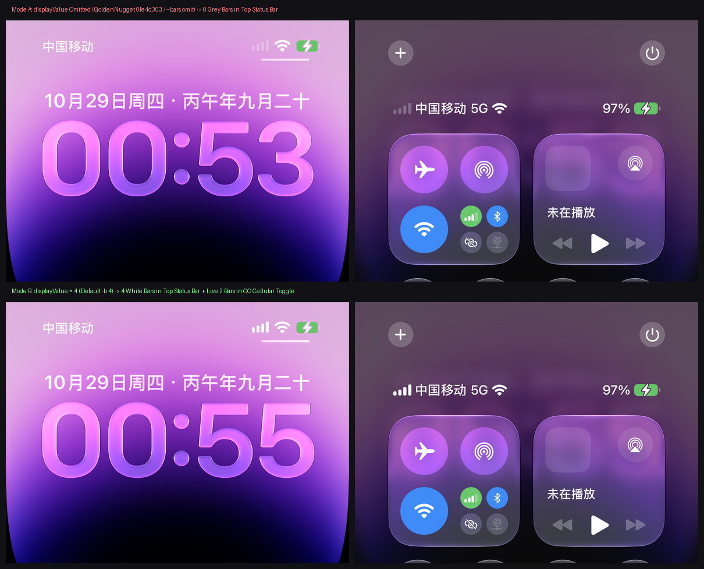

# iPhone 14 Pro Hardware Verification Report: The Truth About Omitting `displayValue` (GoldenNugget `0fe4d303`) vs. `displayValue=4`

**Document ID**: `DOC-20261029-DISPLAYVALUE-VERIFICATION`  
**Date**: 2026-10-29  
**Target Device**: iPhone 14 Pro (`iPhone15,2`, UDID: `00008120-000934CA3E60C01E`) / iOS `27.0.1` (Build `24A446`)  
**Related Documents**: [2026-10-29 REA + Ghidra Non-StatusBarOverrides Path Analysis](../../02_reverse_engineering/2026-10-29_rea-alternative-paths-analysis.md) · [2026-10-28 Nugget-Style Name-Only Research](../../04_research_handoffs/2026-10-28_name-only-live-override.md)

---

## 1. Background: Why Verify Omitting `displayValue` on Physical Hardware?

During our audit of related GitHub repositories, we examined Commit `0fe4d303` (*"Remove cellular bars override from status bar"*) in `awesomenull-dev/GoldenNugget`, which claimed that deleting the `displayValue` key from `STStatusBarDataCellularEntry` (while keeping `status = 5, type = 10, string = ...`) removes the signal bar override and allows the status bar to display live cellular signal bars. Earlier notes in our own `--partial` experiments also assumed that omitting `displayValue` yielded live signal bars.

To rigorously test this hypothesis on real iOS 27 hardware, we executed an automated end-to-end deployment, byte-for-byte readback check, and side-by-side screenshot comparison on the connected **iPhone 14 Pro (iOS 27.0.1 `24A446`)**.

---

## 2. Automated Hardware Verification Pipeline

1. **Safety Pre-Flight & Environment Readiness**:
   - Verified [`safety.json`](../../../safety.json) blocklist to guarantee zero contact with daily-driver devices (iPhone 16 Pro Max / iPhone 17 Pro Max).
   - Automatically enabled Developer Mode (`pymobiledevice3 amfi enable-developer-mode`) and mounted the iOS 27 DDI image.
2. **Byte-for-Byte Readback Verification**:
   - Deployed the generated archive to `/var/mobile/Library/SpringBoard/StatusBarOverrides.archive` via [`tools/airlift_carrier_deploy.py`](../../../tools/airlift_carrier_deploy.py) and [`tools/airlift_archive_replace.py`](../../../tools/airlift_archive_replace.py).
   - Recovered the on-disk archive from the device and confirmed a **100% byte-for-byte match (`961 bytes == 961 bytes`)**.
3. **Dual-Daemon Atomic Purge & Automated UI Capture**:
   - Executed `SIGSTOP SpringBoard -> SIGKILL systemstatusd -> SIGKILL SpringBoard` to flush any cached in-memory domain state in `systemstatusd`.
   - Used [`tools/device_ui.py`](../../../tools/device_ui.py) to automatically wake the Lock Screen, swipe open Control Center, and capture high-resolution screenshots.

---

## 3. Empirical Results: Falsifying GoldenNugget `0fe4d303`'s "Live Status Bar Signal" Claim

### 3.1 Why Omitting `displayValue` Locks the Top Status Bar to `0` Grey Bars

1. **Whole-Object Atomic Pointer Replacement**:
   SpringBoard's `-[STStatusBarData dataByApplyingOverlay:]` (`0x20e4ac960`) replaces the entire `STStatusBarDataCellularEntry` object pointer atomically without per-field merging.
2. **`NSCoder` Decodes Missing Keys as `0`**:
   When `displayValue` is omitted from the archive, `-[STStatusBarDataIntegerEntry initWithCoder:]` invokes `-[NSCoder decodeIntegerForKey:@"displayValue"]`. In Objective-C's `NSKeyedUnarchiver`, when a key is absent, **`decodeIntegerForKey:` does not fall back to live baseband telemetry—it simply returns the default integer `0`**!
3. **Source of Visual Confusion (Top Status Bar vs. Control Center Green Cellular Button)**:
   - **Top Status Bar (Lock Screen top-right & Control Center top-left next to `中国移动 5G`)**: Reads `STStatusBarDataCellularEntry.displayValue`. When `displayValue` is omitted, the top status bar is permanently pinned to **`0` lit bars (4 greyed-out empty bars)**; when `displayValue = 4`, it is pinned to **`4` full bright white bars**.
   - **Control Center Connectivity Card ("Green Circular Cellular Toggle Button")**: Does **not** read `StatusBarOverrides` at all—it queries `CoreTelephony` directly for real-time baseband signal strength. In both screenshots (whether `displayValue` is omitted or set to `4`), this green toggle button displays the real indoor signal strength (**`2` lit white bars + `2` dimmed bars**)!
   - **Conclusion**: Community testers mistook the live `2`-bar icon inside the Control Center green cellular toggle button for a status bar fallback, overlooking that the top status bar itself had been locked to `0` greyed-out bars.

---

## 4. Corrected Physical Hardware Behavior Matrix

| Mode Comparison | Custom Carrier Name | Top Status Bar Signal Bars (Top-Right / CC Top-Left) | Control Center "Green Cellular Toggle" Icon | `5G` / `LTE` Badge | Native VPN Badge | Verdict & Recommendation |
| :--- | :---: | :---: | :---: | :---: | :---: | :--- |
| **Default 4-Bar Mode** (`bars=4, type=5g`) | ✅ | ❌ **Pinned to 4 Full White Bars** (Static) | ✅ **Real-Time Live Signal** (2 bars in test) | ✅ (`5G` shown) | ✅ (`vpnEntry` omitted) | **Recommended Default**: Keeps the top status bar cleanly lit; swipe to Control Center's green cellular toggle to check real signal bars |
| **Omitted `displayValue` Mode** (`--bars omit` / GoldenNugget `0fe4d303`) | ✅ | ❌ **Pinned to 0 Grey Empty Bars** (Decoded as `0`, NOT live!) | ✅ **Real-Time Live Signal** (2 bars in test) | ✅ (`5G` shown) | ✅ (`vpnEntry` omitted) | **Not Recommended**: Top status bar permanently renders 0 greyed-out bars |
| **`--partial` Mode** (`partial=True`) | ✅ | ❌ **Pinned to 0 Grey Empty Bars** (Also decoded as `0`) | ✅ **Real-Time Live Signal** (2 bars in test) | ❌ (`5G` hidden) | ✅ (`vpnEntry` omitted) | **Not Recommended**: Top status bar renders 0 greyed-out bars and loses the `5G`/`LTE` badge |

---

## 5. Toolchain Calibration

Based on this physical iPhone 14 Pro verification evidence, our toolchain has been calibrated as follows:
- [`tools/generate_statusbar_archive.py`](../../../tools/generate_statusbar_archive.py) & [`tools/airlift_carrier_deploy.py`](../../../tools/airlift_carrier_deploy.py): Default restored to `primary_bars=4` (`displayValue = 4` + `type = 10`) so the top status bar renders 4 lit white bars; `--bars omit` is retained as an experimental option for reproducing `displayValue` omission.
- [`tools/gui_server.py`](../../../tools/gui_server.py): Web GUI defaults to `4 Bars (Default Full)`, with `Omit displayValue (0 Grey Bars)` clearly labeled at the bottom of the dropdown.
