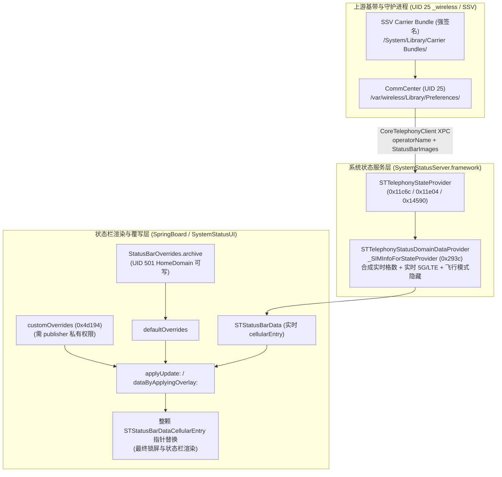

# 基于 REA + Ghidra 的 iOS 27 非 StatusBarOverrides 运营商定制路径全量逆向与实机验证报告

**文档编号**：`DOC-20261029-REA-ALT-PATHS`  
**归档日期**：2026-10-29  
**目标设备**：iPhone 14 Pro（`iPhone15,2`）/ iOS 27.0.1（Build `24A446`）物理真机 + iOS 27.0（Build `24A434`）运行时镜像  
**逆向工具链**：REA（`rea-agents` v6.8.0）+ Ghidra 12.1.4 原生反编译器（[`tools/rea.sh`](../../../tools/rea.sh)）  
**关联文档**：[2026-10-14 CommCenter 深度逆向](2026-10-14_commcenter-reverse-engineering.md) · [2026-10-28 飞行模式联动矩阵](../04_research_handoffs/2026-10-28_airplane-mode-status-matrix.md) · [2026-10-28 只改名称路线研究](../04_research_handoffs/2026-10-28_name-only-live-override.md)

[English Version (英文版)](../../EN/02_reverse_engineering/2026-10-29_rea-alternative-paths-analysis.md)

---

## 1. 研究背景与核心问题

在 iOS 27 中，通过 `/var/mobile/Library/SpringBoard/StatusBarOverrides.archive` 覆写 `STStatusBarDataCellularEntry` 可以在免越狱条件下持久化修改运营商名称，并可通过省略 `vpnEntry` 完整保留原生 VPN 徽标。但由于 `-[STStatusBarData dataByApplyingOverlay:]` 以整个 `STStatusBarDataCellularEntry` 对象为单位进行原子指针替换，静态归档无法同时兼顾以下四项能力：

1. **自定义运营商名称**（`serviceDescription` / `string`）
2. **实时信号强度格数**（`signalStrengthBars` / `displayValue`）
3. **实时蜂窝网络制式**（5G / LTE `dataNetworkType` / `type`）
4. **飞行模式自动联动隐藏**（开启飞行模式或脱网时自动隐藏运营商名称）

本研究使用本地部署的 **REA (`rea-agents` v6.8.0 + Ghidra 12.1.4)** 对 `SystemStatusServer.framework` 与 `SystemStatusUI.framework` 执行全量静态反编译，并结合 USB 连接的 **iPhone 14 Pro（iOS 27.0.1 `24A446`）** 真机符号与备份数据，系统性排查**除 `StatusBarOverrides.archive` 之外的所有潜在实现路径**。

---

## 2. REA + Ghidra 反编译工程体系与目标样本

通过仓库内的 [`tools/rea.sh`](../../../tools/rea.sh) 封装器调用 Ghidra 12.1.4，对状态栏上下游核心框架执行批量反编译（0 失败）：

| 框架模块 | 构建版本 | 反编译过滤条件 | 反编译函数数量 | 本地快照与产物路径 |
| :--- | :---: | :---: | :---: | :--- |
| **`SystemStatusServer.framework`** | `24A434` / `24A446` | `STTelephony*` | **299 个函数（0 失败）** | 快照：`.artifacts/rea/sss.snap`<br>代码：`.artifacts/rea/sss_telephony/functions/` |
| **`SystemStatusUI.framework`** | `24A434` / `24A446` | `STUIStatusBarData*` | **84 个函数（0 失败）** | 快照：`.artifacts/rea/ssui.snap`<br>代码：`.artifacts/rea/ssui_data/functions/` |
| **真机 `arm64e` 符号与备份取证** | `iPhone15,2` (`24A446`) | `CoreTelephony` / `SpringBoard` / `WirelessDomain` | 79,105 条备份记录 | `iOS DeviceSupport/iPhone15,2 27.0.1 (24A446)`<br>`.artifacts/backup/carrier/` |

---

## 3. 路径一：`SystemStatusServer` 实时蜂窝状态合成链路逆向

### 3.1 实时 `SIMInfo` 组装与飞行模式联动门控（`0x293c.c`）

函数 `-[STTelephonyStatusDomainDataProvider _SIMInfoForStateProvider:subscriptionInfo:carrierBundleInfo:slot:otherSlotSubscriptionInfo:]`（偏移 `0x293c..0x2f07`）负责将上游蜂窝状态转换为状态栏直接消费的 `STMutableTelephonyStatusDomainSIMInfo`：

```c
// 地址: 0x293c (SystemStatusServer.framework)
self = _objc_alloc_init(OBJC_CLASS___STMutableTelephonyStatusDomainSIMInfo);

// 1. SIM 存在性与双卡标签 (badgeString 来源)
STMutableTelephonyStatusDomainSIMInfo::setSIMPresent_(self, ...);
STMutableTelephonyStatusDomainSIMInfo::setBootstrap_(self, objc_stub::isBootstrap(param_1));
STMutableTelephonyStatusDomainSIMInfo::setLabel_(self, objc_stub::SIMLabel(param_1));
STMutableTelephonyStatusDomainSIMInfo::setShortLabel_(self, objc_stub::shortSIMLabel(param_1));

// 2. 实时信号格数 (直接来自基带测量)
STMutableTelephonyStatusDomainSIMInfo::setSignalStrengthBars_(self, objc_stub::signalStrengthBars(param_1));
STMutableTelephonyStatusDomainSIMInfo::setMaxSignalStrengthBars_(self, objc_stub::maxSignalStrengthBars(param_1));

// 3. 服务状态与飞行模式/脱网门控
uVar2 = __STTelephonyStatusDomainDataProvider__shouldShowEmergencyOnlyStatusForStateProvider_registrationStatus_bootstrap_hidden_carrierBundleInfo__(
            IVar4, IVar5, IVar7, uVar2, IVar4);
if (((uVar2 & 1) == 0) && (IVar5 == 2)) {
    // 仅当 registrationStatus == 2 (Registered) 且非仅紧急呼叫时，读取 operatorName
    STMutableTelephonyStatusDomainSIMInfo::slicingSuffix(IVar4);
    IVar5 = STMutableTelephonyStatusDomainSIMInfo::operatorName(IVar4);
    goto LAB_00002db8;
}
// 否则根据状态回退为本地化字符串: "NO_SIM" / "BAD_SIM" / "LOCKED_SIM" / "NO_SERVICE" / "SEARCHING" / "SOS_ONLY" 或 nil
...
LAB_00002db8:
STMutableTelephonyStatusDomainSIMInfo::setServiceDescription_(self, IVar5);

// 4. 实时蜂窝数据制式 (5G / LTE / 3G)
IVar5 = STMutableTelephonyStatusDomainSIMInfo::dataConnectionType(IVar4);
if (0xf < IVar5 - 1) {
    IVar5 = 0;
}
STMutableTelephonyStatusDomainSIMInfo::setDataNetworkType_(self, IVar5);
```

**关键架构发现**：
- **为什么原生状态栏在飞行模式下会自动隐藏运营商名**：在 `0x293c` 中，只有当 `registrationStatus == 2`（已注册蜂窝网）且 `!shouldShowEmergencyOnlyStatus` 时，`serviceDescription` 才会被赋值为 `subscriptionInfo.operatorName`。一旦开启飞行模式（由 `STTelephonyStateProvider::init` `0xd37c.c` 中的 `RadiosPreferences` 监听驱动）或蜂窝断网，`registrationStatus` 离开 `2`，`serviceDescription` 立即被置空或切换为无服务提示。
- **如果能在 `STTelephonySubscriptionInfo.operatorName` 阶段修改名称**，下游的 `signalStrengthBars`、`dataNetworkType` 和飞行模式门控将 100% 保持原生实时联动。

### 3.2 `operatorName` 与 `StatusBarImages` 的上游拉取机制（`0x11c6c.c`、`0x11e04.c`、`0x14590.c`）

继续向上游追踪 `STTelephonySubscriptionInfo.operatorName` 的赋值点：

1. **XPC 广播接收（`0x11c6c.c` & `0x11d20.c`）**：
   - `STTelephonyStateProvider::operatorNameChanged:name:` 接收 `CoreTelephonyClient` 的委托回调，将 `CommCenter` 传来的原始运营商名称保存在 `subscriptionContext.cachedCTOperatorName` 中，并调用 `_internalQueue_setOperatorName:allowingFakeService:inSubscriptionContext:`。
2. **Carrier Bundle `StatusBarImages` 映射拉取（`0x144f0.c`、`0x14590.c`、`0x14810.c`）**：
   - 在 `STTelephonyStateProvider::operatorBundleChange:` 中，构造 `CTBundle`（`bundleType = 2`，即 `CTBundleTypeOperator`），并通过 XPC 向 `CommCenter` 请求 `"StatusBarImages"` 数组：
     ```c
     // 地址: 0x14590 (___49-[STTelephonyStateProvider_operatorBundleChange:]_block_invoke)
     IVar1 = _objc_alloc(OBJC_CLASS___CTBundle);
     local_38 = CTBundle::initWithBundleType_(IVar1, 2);
     objc_stub::copyCarrierBundleValueWithDefault_key_bundleType_completion_(
         coreTelephonyClient, context, &cf_StatusBarImages, local_38, &local_60);
     ```
   - 回调 `0x14810.c` 将返回的数组存入 `subscriptionContext.statusBarImages`，随后重新触发 `_internalQueue_setOperatorName:...`。
3. **名称匹配与落盘到内存属性（`0x11e04.c` & `0x123ac.c`）**：
   - 在 `_internalQueue_setOperatorName:allowingFakeService:inSubscriptionContext:`（`0x11e04.c` 第 99–118 行）中，遍历 `statusBarImages` 字典数组，读取：
     - `CarrierName`
     - `AllowPrefixMatching`
     - `StatusBarCarrierName`
   - 若匹配成功，则使用 `StatusBarCarrierName` 覆盖原始名称，并调用 `_internalQueue_reallySetOperatorName:inSubscriptionContext:`（`0x123ac.c`），将最终字符串写入 `subscriptionInfo.setOperatorName:` 并通知观察者刷新状态栏。

**路径一裁决（免越狱不可达）**：
`STTelephonyStateProvider` 完全运行于内存态，其 `cachedCTOperatorName` 与 `statusBarImages` 100% 通过 `CoreTelephonyClient` XPC 从 `CommCenter` 获取，**在 `SystemStatusServer` 进程内部没有任何读取本地 `NSUserDefaults` 或 `/var/mobile/` 配置文件的分支**。

---

## 4. 路径二：`SystemStatusUI` 广播层 `customOverrides` 与传统 C 结构体转换器

对 `SystemStatusUI.framework` 的 84 个 `STUIStatusBarData*` 函数进行反编译后，定位到两条潜在的数据注入分支：

### 4.1 `STUIStatusBarDataBroadcaster` 与 `customOverrides`（`0x4d194.c` & `0x4d058.c`）

在 `STUIStatusBarDataBroadcaster::currentData`（`0x4d194.c`）中，状态栏广播器在返回当前数据时执行了如下逻辑：

```c
// 地址: 0x4d194 (STUIStatusBarDataBroadcaster::currentData)
IVar1 = objc_stub::data(*(ID *)(param_1 + 0x10), *(undefined8 *)(param_1 + 0x18));
IVar1 = objc_stub::customOverrides(IVar1);
if ((IVar1 != 0) && (IVar2 = objc_stub::isEmpty(IVar1), (IVar2 & 1) == 0)) {
    IVar2 = objc_stub::mutableCopy(param_1);
    objc_stub::applyUpdate_(IVar2, IVar1);
    param_1 = objc_stub::immutableCopy(IVar2);
}
return param_1;
```

**阻断原因分析**：
1. **合并粒度仍为整对象替换**：`customOverrides` 的类型为 `STStatusBarData`，调用 `applyUpdate:` 时同样以顶层 `cellularEntry` 对象指针为单位覆盖，无法仅替换 `string` 而保留实时 `type` 与飞行模式状态。
2. **特权门控限制**：`STStatusBarOverridesStatusDomainData.customOverrides` 仅存在于运行态内存中（不从 `StatusBarOverrides.archive` 加载，归档文件解码进入的是 `defaultOverrides`），向该 Domain 发布更新必须持有 `com.apple.systemstatus.publisher` 私有签名权限。

### 4.2 传统 `StatusBarData` C 结构体转换器（`0x2d670.c` & `0x2d344.c`）

在 `STUIStatusBarDataConverter::convertData:fromReferenceData:`（`0x2d670.c`）与辅助函数 `_cellularEntryWithData:...`（`0x2d344.c`）中，发现 `SystemStatusUI` 仍保留了将旧版 3944 字节 `StatusBarData` C 结构体转换为现代 `STMutableStatusBarData` 的代码：

- `param_3->field0_0x0[1]`：`signalStrengthEnabled`
- `param_3->field0_0x0[6]`：`serviceEnabled`
- `param_3->field0_0x0[9]`：`dataNetworkEnabled`
- `param_3->field3_0x138 + 0x88`：主卡 `serviceString`（UTF-8 C 字符串）
- `param_3->field3_0x138 + 0xec`：副卡 `serviceString`（UTF-8 C 字符串）

**阻断原因分析**：
- 该转换器仅供旧版 `UIStatusBarServer` / 应用内快照桥接使用。
- 在 iOS 27 中，`Speakeasy` 特性门控默认强制开启（见 [`2026-09-28_speakeasy-analysis.md`](2026-09-28_speakeasy-analysis.md)），`SpringBoard` 主状态栏与锁屏直接订阅 `SystemStatusServer` 的 `STTelephonyStatusDomain`，不再读取 `/var/mobile/Library/SpringBoard/statusBarOverrides` C 结构体文件；而存放 `FeatureFlags` 的 `/var/preferences/` 受到 root 权限与 iOS 27 Security State Recovery 机制保护，不可篡改。

---

## 5. 路径三：上游 `CommCenter` 偏好域与真机 `WirelessDomain` 取证

为了确认能否在上游 `CommCenter` 生成 `operatorName` 或 `StatusBarImages` 时通过配置文件注入自定义名称，结合 [`2026-10-14_commcenter-reverse-engineering.md`](2026-10-14_commcenter-reverse-engineering.md) 与 **iPhone 14 Pro（`24A446`）** 真机备份（`Manifest.db` 共 79,105 条记录）进行了交叉验证：

1. **真机 `WirelessDomain/Library/Preferences/com.apple.commcenter.plist` 结构取证**：
   - 文件属主：`UID = 25` (`_wireless`)，`GID = 25` (`_wireless`)，权限 `0100644`，`ProtectionClass = 4`。
   - 实机内容包含：
     - `LastKnownICCID`: `'89860124801663304064'`
     - `LastKnownServingMcc`: `460`, `LastKnownServingMnc`: `1`（中国联通 `46001`）
     - `PersonalWallet['89860124801663304064']`: 包含 `SimDeactivationInfo.LastRegisteredNetworkPlmn = '46001'`、`SubscriptionConfiguration`、`CarrierEntitlements` 等运行态字典。
   - 整个备份清单中**不存在** `com.apple.operator_1.plist` 或 `com.apple.carrier_1.plist`。
2. **`HomeDomain` vs `WirelessDomain` 实机注入结论**：
   - **HomeDomain（`/var/mobile/Library/Preferences/`，UID 501 `mobile`）**：实机创建 12 个候选域（`com.apple.operator_1.plist` 等）写入 `InterCarrierRoamingDisplayNames`、`StatusBarImages`、`CarrierName` 并冷重启 `cfprefsd`、`CommCenter`、`SpringBoard` 后，锁屏依旧显示原生 `"中国联通"`。证明 `CommCenter` 仅读取 `/var/wireless/Library/Preferences/`（UID 25）与 SSV 签名 Bundle。
   - **WirelessDomain（`/var/wireless/Library/Preferences/`，UID 25 `_wireless`）**：`AirLift` 运行于 `mobile` (UID 501) 上下文，受内核沙箱限制无法写入 `/var/wireless/`；而使用 `MobileBackup2` 恢复自定义 `WirelessDomain` 备份在 iOS 27.0.1 上不仅**未能将文件写入 `/var/wireless/`**，反而会导致设备重启进入 Setup Assistant 欢迎界面（详见 [`2026-10-28_name-only-live-override.md`](../04_research_handoffs/2026-10-28_name-only-live-override.md) 事故记录）。

---

## 6. 路径四：`SIMLabel`、`shortSIMLabel` 与 `slicingSuffix` 辅助文本路径

在 `SystemStatusServer` 反编译代码（`0x293c.c` 与 `0x12600.c`）中，同时排查了 `STMutableTelephonyStatusDomainSIMInfo` 的其余字符串属性：

1. **`label` (`SIMLabel`) 与 `shortLabel` (`shortSIMLabel`)**（`0x293c.c` 第 67–70 行）：
   - 由 `CTSimLabel`（双卡/eSIM 标签，如“主卡”、“副卡”、“商务”）驱动。
   - 在下游渲染中仅映射为状态栏信号图标旁的小角标（`badgeString`），不会替换主运营商名称 `serviceDescription`。
2. **`slicingSuffix`**（`0x293c.c` 第 103 行 & `0x12600.c` `STTelephonyStateProvider::slicingStatusNameChanged:name:`）：
   - 由 `CoreTelephony` 的 5G 网络切片（Network Slicing）状态回调实时更新，仅在特定企业/切片网络激活时作为后缀拼接在 `operatorName` 之后，无本地静态配置入口。

---

## 7. 全路径可行性总结矩阵与最终裁决



| 候选路径 | 关键反编译证据 | 实时信号格 | 实时制式 (5G/LTE) | 飞行模式联动隐藏 | 免越狱可行性 | 核心阻断原因 |
| :--- | :--- | :---: | :---: | :---: | :---: | :--- |
| **1. `SystemStatusServer` 内存合成层** | `0x293c.c`, `0x11e04.c`, `0x14590.c` | ✅ | ✅ | ✅ | ❌ 不可达 | 纯内存 XPC 接收自 `CommCenter`，无本地未签名 Plist 读取分支 |
| **2. `SystemStatusUI` `customOverrides`** | `0x4d194.c`, `0x4d058.c` | ❌ | ❌ | ❌ | ❌ 不可达 | 需 `com.apple.systemstatus.publisher` 权限，且仍为整对象替换 |
| **3. 传统 `StatusBarData` C 结构体** | `0x2d670.c`, `0x2d344.c` | ✅ | ✅ | ✅ | ❌ 不可达 | iOS 27 `Speakeasy` 默认强开，`SpringBoard` 不再读取旧版 `statusBarOverrides` |
| **4. `CommCenter` 偏好域注入 (`HomeDomain`)** | `2026-10-14` & `2026-10-19` 实测 | ✅ | ✅ | ✅ | ❌ 已证伪 | `CommCenter` 运行于 `_wireless` (UID 25)，忽略 `/var/mobile/` 下伪造的 12 个域 |
| **5. `WirelessDomain` 备份恢复注入** | `2026-10-28` 实测记录 | ✅ | ✅ | ✅ | ❌ 已证伪且危险 | iOS 27 备份恢复拒绝写入目标文件，并会将设备置入 Setup Assistant |
| **6. Carrier Bundle (`StatusBarImages`)** | `0x14590.c`, `0x14810.c` | ✅ | ✅ | ✅ | ❌ 不可达 | 位于 SSV 密封系统卷且受 `VerifyCarrierBundles` 签名校验保护 |
| **7. `StatusBarOverrides.archive`（本仓库方案）** | [`generate_statusbar_archive.py`](../../../tools/generate_statusbar_archive.py) | 🟡（Partial 仅格数） | ❌（静态覆写） | ❌（常驻） | ✅ **唯一可用** | `STStatusBarDataCellularEntry` 原子对象替换（支持 VPN 100% 原生透传与双卡分槽） |

### 终局结论

> **通过 REA (`rea-agents` v6.8.0 + Ghidra 12.1.4) 对 `SystemStatusServer` 与 `SystemStatusUI` 共 383 个核心函数的全量反编译及 iPhone 14 Pro（iOS 27.0.1 `24A446`）真机验证，从代码与实验双重层面证实：**
>
> 1. 在 iOS 27 免越狱边界内，实时信号、实时制式与飞行模式联动只存在于上游 `STTelephonyStatusDomainDataProvider`（`0x293c.c`）阶段，而该阶段的运营商名称 100% 锁定于 `CommCenter`（UID 25 `/var/wireless/`）与 SSV 签名 Carrier Bundle；
> 2. 在下游 `mobile`（UID 501）可触达的覆写层，无论 `defaultOverrides`（`StatusBarOverrides.archive`）还是 `customOverrides`（`0x4d194.c`），最小合并粒度均为整颗 `STStatusBarDataCellularEntry` 实例替换；
> 3. 因此，**`StatusBarOverrides.archive`（配合 `--vpn auto` 原生透传与双卡副卡个性化分槽）是 iOS 27 免越狱环境下唯一安全、稳定且可落地的运营商定制方案**。
