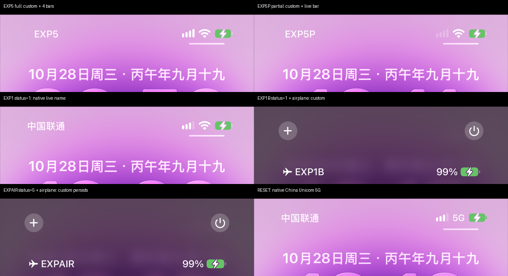

# iOS 27 飞行模式联动矩阵实验记录（2026-10-28）

**文档编号**：`DOC-20261028-AIRPLANE-MATRIX`  
**实验日期**：2026-10-28  
**设备**：iPhone 14 Pro（iPhone15,2）/ iOS 27.0.1（24A446）/ USB  
**工具链**：REA 6.8.0 + Ghidra 12.1.4 + 本仓库 AirLift / CoreDevice 实验台  
**关联文档**：[2026-10-28 研究路线图](2026-10-28_next-research-roadmap.md)

> **设备说明**：本次通过 `devicectl` 实际连接的设备是 **iPhone 14 Pro（iPhone15,2）**，不是 iPhone 14 Pro Max；当前没有 14 Pro Max 通过 USB 出现。实验只在 14 Pro 测试机上进行，主力 iPhone 16 Pro Max 与未确认归属的 iPhone 17 Pro Max 已在 `safety.json` 中列入黑名单。

---

## 1. 本次新增的部署与能力

1. **REA 6.8.0**：本地安装于 `.tools/rea-cli`，使用 Node 24.22.1。
2. **Ghidra 12.1.4**：下载官方 release，并为 Apple Silicon 现场编译 `os/mac_arm_64/decompile`（官方 zip 未附带该原生反编译器）。
3. **REA 的 Hopper provider 被 macOS Automation 权限阻断**（`Not authorized to send Apple events`），因此本次改走 Ghidra headless；Hopper 仍保留为后续可选路径。
4. **`ps` shim**：DSH 的 workspace-write 沙箱拒绝 `/bin/ps`（EPERM），而 REA 的进程所有权检查依赖进程表。新增 `.tools/bin/ps`，用 `libproc`（`proc_listpids` / `proc_pidinfo` / `proc_pidpath`）提供同等字段，使 REA 能正常完成清理与结果返回。
5. **实验台**：新增 [`tools/exp_status_matrix.py`](../../../tools/exp_status_matrix.py)，支持：
   - 显式选择 14 Pro；
   - 原子替换归档并保存旧归档；
   - `SIGSTOP` SpringBoard → `SIGKILL` `systemstatusd` → `SIGKILL` SpringBoard；
   - 自动截图 Lock Screen / Control Center；
   - `--reset` 一键恢复原生。
6. **安全护栏**：`PRIMARY_PHONE_BLOCKLIST` 改为从 `safety.json` + `AIRLIFT_BLOCKED_UDIDS` 读取，并在为空时 fail-closed；`airlift/airlift_carrier_deploy.py` 改为 `tools/` 实现的 wrapper，避免旧副本绕过安全检查。

---

## 2. 静态证据：名称门控的精确伪代码

用 REA + Ghidra 反编译 `-[STUIStatusBarCellularItem applyUpdate:toDisplayItem:]`（文件偏移 `0x2c1c`），名称分支为：

~~~c
if (identifier == nameDisplayIdentifier) {
    string = entry.string;
    enabled = displayItem.isEnabled
           && string.length > 0
           && !entry.isBootstrapCellular;
    displayItem.enabled = enabled;
    if (!enabled) return;
    serviceNameView.text = string;
    serviceNameView.alternateText = entry.crossfadeString;
    serviceNameView.marqueeRunning = YES;
    return;
}
~~~

关键点：

- 名称门控只读 **覆写条目** 的 `displayItem.isEnabled`、`string`、`isBootstrapCellular`；
- 它 **不读** `STTelephonyStatusDomain` 的实时注册状态；
- `displayItem.isEnabled` 由覆写数据/基础 item 逻辑决定，而不是由 live telemetry 逐帧决定；
- 因此，静态归档不存在「名称可见性跟随蜂窝状态」的字段级绑定。

这与 2026-10-21 的 `dataByApplyingOverlay:` 整条目原子替换结论一致。

---

## 3. 动态矩阵结果（iPhone 14 Pro / 27.0.1）

每个 variant 均通过 `replace_archive` 写入，并执行 `SIGSTOP` SpringBoard → `SIGKILL` systemstatusd → `SIGKILL` SpringBoard，等待新 SpringBoard 后截图。字段默认 `enabled=true`，除注明外省略 `displayValue` 与 `type`。

| `status` | 蜂窝开启：锁屏 | 蜂窝开启：控制中心 | 飞行模式：控制中心 | 结论 |
|:---:|---|---|---|---|
| 0 | 无名称、无蜂窝格 | 无名称、无蜂窝指示 | 无名称 | 名称被隐藏，蜂窝指示也消失 |
| 1 | **原生「中国联通」+ 实时格** | **原生「中国联通 5G」+ 实时格** | **自定义名称「EXP1B」+ 飞行图标** | live-fallback：有 live 时用原生名，无 live 时用覆写名；方向与需求相反 |
| 2 | 无名称、4 个点 | 无名称、点状指示 | 无名称 | 名称隐藏 |
| 3 | 无名称、低格 | 无名称、低格 | 无名称 | 名称隐藏 |
| 4 | 无名称、警告三角 | 无名称、警告三角 | 无名称 | 名称隐藏 |
| 5 | **自定义名称 + 4 格** | **自定义名称 + 5G + 4 格** | **自定义名称常驻 + 飞行图标** | 名称被静态钉住；飞行模式不隐藏 |
| 255 | 无名称 | 自定义名称 + 点状指示 | 无名称 | 未定义/不一致，不建议使用 |
| 5 + `isBootstrapCellular=true` | 无名称、4 格 | 未单独采集 | 未单独采集 | `isBootstrapCellular` 会直接压掉名称 |
| 5 + 省略 `displayValue/type` | 自定义名称 + 实时格（本次 1 格） | 自定义名称 + 实时格 + 无制式文字 | 未单独采集 | partial 模式：名称仍常驻 |

> 说明：`status=1` 的飞行模式证据来自 Control Center 截图；锁屏未单独采集，因此表中只写 CC。`status=255` 在锁屏和 CC 之间不一致，按「未定义」处理。
>
> 实验结束后已执行 `--reset`，设备恢复原生「中国联通 5G」并停留在主屏幕。

### 3.1 关键观察

1. **没有找到「蜂窝开启显示自定义名 + 飞行模式自动隐藏」的静态组合。**
2. `status=1` 确实表现出**与 live 状态耦合**的行为，但方向相反：有 live 时显示原生名，无 live 时显示覆写名。它不是自定义名称模式，而是「live fallback」模式。
3. `status=0/2/3/4` 会隐藏名称，但同时也改变/移除蜂窝信号指示，不能用于正常状态。
4. `status=5` 是唯一稳定的自定义名称模式，但它在飞行模式常驻。
5. `isBootstrapCellular=true` 是直接隐藏名称的开关，不能用于条件显示。
6. 部分模式（省略 `displayValue/type`）可实现「自定义名称 + 实时信号格」，但制式文字被抑制，且名称仍常驻飞行模式。

---

## 4. 结论

在 iOS 27.0.1 / iPhone 14 Pro 上，**静态 `StatusBarOverrides.archive` 没有可用组合实现「自定义运营商名称 + 飞行模式自动隐藏 + 实时信号/制式」**。

- `status=5`：自定义名称被静态钉住；
- `status=1`：live 优先，显示原生名；飞行模式才显示覆写名（与需求相反）；
- `status=0/2/3/4`：名称隐藏，蜂窝指示也异常；
- 名称门控不读 live telephony，因此不存在字段级条件绑定。

要实现真正的动态名称，只剩运行时发布 `STStatusBarOverridesStatusDomain` 的路径，需要 `com.apple.systemstatus.publisher` entitlement，超出非越狱边界。产品上仍建议：

1. 默认使用 `status=5` full 模式（名称 + 固定格/制式）；
2. 需要实时格时使用 `--partial`（名称 + 实时格，但无制式文字，且飞行模式常驻）；
3. 双卡设备用副卡槽展示自定义名，主卡保持原生，以获得主卡的飞行模式联动。

---

## 5. 仍待完成的实验

| 实验 | 目的 | 状态 |
|---|---|---|
| `status=1` 飞行模式锁屏截图 | 确认锁屏是否与 CC 一致 | 待做 |
| `enabled=false` + `status=1` | 是否可在飞行模式隐藏自定义名 | 待做 |
| `status=6` / `-1` / 其他哨兵 | 是否存在特殊合并语义 | 待做 |
| `displayValue` 哨兵（-1/255/65535） | 是否可恢复制式文字 | 待做 |
| live domain 日志与磁盘归档 diff | 量化 live 合并/回写窗口 | 待做 |
| iOS 27.2 | 设备已提示 27.2 可用；需另开兼容性测试，勿直接升级测试机 | 待规划 |

---

## 6. 复现命令

~~~bash
# 1) 安全护栏（本机 safety.json 已包含主力机 UDID）
python3 -c "import sys; sys.path.insert(0,'tools'); import airlift_carrier_deploy as A; print(sorted(A.PRIMARY_PHONE_BLOCKLIST))"

# 2) 应用 variant（自动保存旧归档、purge、截图）
python3 tools/exp_status_matrix.py --name EXP5 --set status=5 --set enabled=true \
  --set displayValue=4 --set type=10 --screenshot --control-center

# 3) 部分覆写
python3 tools/exp_status_matrix.py --name EXP5P --set status=5 --set enabled=true \
  --omit displayValue --omit type --screenshot --control-center

# 4) 恢复原生
python3 tools/exp_status_matrix.py --reset --screenshot --control-center

# 5) 飞行模式切换（Control Center 坐标，iPhone 14 Pro）
python3 tools/device_ui.py open-cc
python3 tools/device_ui.py tap 10003 12820
python3 tools/device_ui.py screenshot .artifacts/screens/airplane-cc.png
~~~

> 飞行模式按钮坐标按 1179×2556 截图换算：x≈180 px → 10003，y≈500 px → 12820。不同机型/布局需重新测量。

---

## 7. 证据文件

- 实验台：[`tools/exp_status_matrix.py`](../../../tools/exp_status_matrix.py)
- REA 本地包装器：[`tools/rea.sh`](../../../tools/rea.sh)
- REA 反编译输出：`.artifacts/rea/ssui_decomp_apply.json`、`.artifacts/rea/ssui_decomp_0x563bc.json`、`.artifacts/rea/ssui_decomp_0x56288.json`
- 截图：`.artifacts/screens/EXP5-lock-20261028-095021.png`、`EXP5P-lock-20261028-101114.png`、`EXPB-lock-20261028-101143.png`、`EXPAIR-airplane-lock.png`、`EXP1B-airplane-cc.png`、`RESET-lock-20261028-101918.png`
- 汇总图：[`assets/ios27_status_matrix_20261028.png`](../../../assets/ios27_status_matrix_20261028.png)
- 旧归档：`.artifacts/archives/old-*.archive`

---

## 8. 一句话结论

> **`status=1` 的 live-fallback 证明了系统确实会在「有 live / 无 live」之间切换优先级，但切换方向是「有 live 用原生名、无 live 用覆写名」，恰好与产品需求相反；`status=5` 则把自定义名静态钉死。静态归档路线在非越狱边界内没有可用的飞行模式联动组合。**
